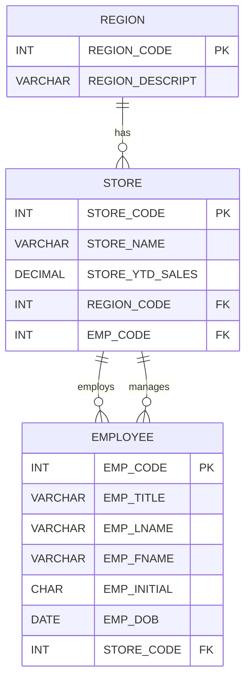

# 🏪 Store Database — Homework 4

SQL Server script that models a retail store management system from scratch.

---

## 📐 Schema Overview



> **Note:** `STORE.EMP_CODE` and `EMPLOYEE.STORE_CODE` form a deliberate circular reference
> (a store has a manager who is an employee; an employee works at a store).
> This is handled by inserting STORE rows with the manager FK temporarily disabled,
> then inserting EMPLOYEE rows, and finally re-enabling & validating the FK.

---

## ✅ Requirements Checklist

| Requirement | Implementation |
|---|---|
| `Store` database | Created with `IF DB_ID('Store') IS NULL` guard |
| Three tables matching the image | `REGION`, `STORE`, `EMPLOYEE` with correct columns & types |
| All rows from the image | 2 regions · 5 stores · 21 employees |
| Primary & Foreign Keys | `PK_*` and `FK_*` constraints on every table |
| **SEQUENCE** for `EMP_CODE` | `dbo.SEQ_EMP_CODE` — values assigned via `NEXT VALUE FOR` |
| **DEFAULT** `STORE_CODE = 3` | `DF_EMP_STORE` default constraint on `EMPLOYEE.STORE_CODE` |
| **CHECK** `STORE_YTD_SALES > 0` | `CK_STORE_YTD` check constraint on `STORE` |
| Idempotent (re-runnable) | Drops FKs → tables → sequence before re-creating |

---

## 🗂️ Files

| File | Description |
|---|---|
| [`script.sql`](./script.sql) | Complete, self-contained T-SQL setup script |
| [`README.md`](./README.md) | This file |

---

## ▶️ How to Run

### Option A — SSMS / Azure Data Studio

1. Open `script.sql`.
2. Connect to any SQL Server 2016+ instance.
3. Press **F5** (or click *Execute*).
4. The script creates the `Store` database, all objects, and inserts all data.
5. Three `SELECT` statements at the end show the final data.

### Option B — `sqlcmd`

```bash
sqlcmd -S localhost -E -i script.sql
```

---

## 🔑 Key Design Decisions

### SEQUENCE
```sql
CREATE SEQUENCE dbo.SEQ_EMP_CODE
    AS INT START WITH 1 INCREMENT BY 1;

-- Usage during INSERT:
INSERT INTO dbo.EMPLOYEE (EMP_CODE, ...) VALUES
    (NEXT VALUE FOR dbo.SEQ_EMP_CODE, ...);
```

### DEFAULT constraint
```sql
STORE_CODE INT NOT NULL
    CONSTRAINT DF_EMP_STORE DEFAULT 3
```
If `STORE_CODE` is omitted during an `INSERT`, SQL Server automatically writes `3`.

### CHECK constraint
```sql
CONSTRAINT CK_STORE_YTD CHECK (STORE_YTD_SALES > 0)
```
Any `INSERT` or `UPDATE` that sets `STORE_YTD_SALES` ≤ 0 is rejected with an error.

### Circular FK handling
Because `STORE` references `EMPLOYEE` (manager) **and** `EMPLOYEE` references `STORE` (workplace), the insertion order is:

```
1. INSERT REGION          -- no dependencies
2. INSERT STORE           -- FK to EMPLOYEE temporarily disabled (NOCHECK)
3. INSERT EMPLOYEE        -- FK to STORE is live; all STORE rows already exist
4. RE-ENABLE & VALIDATE   -- FK_STORE_EMP checked against real data
```

---

## 📊 Sample Data

### REGION
| REGION_CODE | REGION_DESCRIPT |
|---|---|
| 1 | East |
| 2 | West |

### STORE
| STORE_CODE | STORE_NAME | STORE_YTD_SALES | REGION_CODE | EMP_CODE |
|---|---|---|---|---|
| 1 | Access Junction | 1,003,455.76 | 2 | 8 |
| 2 | Database Corner | 1,421,987.39 | 2 | 12 |
| 3 | Tuple Charge | 986,783.22 | 1 | 7 |
| 4 | Attribute Alley | 944,568.56 | 2 | 3 |
| 5 | Primary Key Point | 2,930,098.45 | 1 | 15 |

### EMPLOYEE (first 5 rows)
| EMP_CODE | EMP_TITLE | EMP_LNAME | EMP_FNAME | EMP_INITIAL | EMP_DOB | STORE_CODE |
|---|---|---|---|---|---|---|
| 1 | Mr. | Williamson | John | W | 1964-05-21 | 3 |
| 2 | Ms. | Ratula | Nancy | *(NULL)* | 1969-02-09 | 2 |
| 3 | Ms. | Greenboro | Lottie | R | 1961-10-02 | 4 |
| … | … | … | … | … | … | … |

---

## 🛠️ SQL Server Version

Tested on **SQL Server 2016+** (requires `SEQUENCE` support, available since SQL Server 2012).

